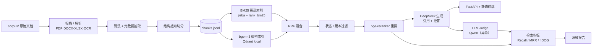

# 智慧停车企业知识库 RAG 问答助手

面向停车运营企业的知识库问答：把标准、收费办法、设备手册、客服规范混合语料入库，用「稠密 + 稀疏混合检索 → 状态/版本过滤 → 重排 → 带引用生成」回答问题，并用可复现的消融评估说明每一层到底带来了多少收益。

## 架构



## 快速开始

```bash
pip install -e ".[dev]"
python scripts/ingest.py --corpus corpus --data data     # 入库：解析 → 清洗 → 切分 → data/chunks.jsonl
python scripts/serve.py --device cpu                    # 起服务，浏览器打开 http://127.0.0.1:8000
```

无实时环境时（离线、无 API key）可以只跑测试与重建报告：

```bash
python -m pytest -q
python scripts/eval.py --report-only --verdicts eval/judge_verdicts.jsonl --out reports/eval_report.md
```

有 `Makefile` 的机器上等价于 `make ingest` / `make dev` / `make test` / `make eval-report`（Windows 未装 make 时直接用上面的命令）。

完整评估（需要 `.env` 中的 DeepSeek / SiliconFlow key，首次会下载 bge-m3 与 bge-reranker）：

```bash
python scripts/build_eval_set.py --chunks data/chunks.jsonl --out eval/questions.jsonl
python scripts/eval.py --questions eval/questions.jsonl \
  --configs dense_only,dense_bm25_rrf,dense_bm25_rrf_rerank,full \
  --out reports/eval_report.md --device cpu
```

## 评估结果

> **状态：尚未运行。** 真实评估需要 API key 与两个 bge 模型（约 2–3 GB），当前环境未配置。
> 下表的数字是设计文档 §9 的**目标值**，不是实测值。跑到之后会用实测数字替换，达不到也照实写原因。

| 配置 | Recall@5 | 答案正确率 | 引用精确率 | 拒答准确率 |
| --- | --- | --- | --- | --- |
| dense_only | 待运行 | 待运行 | 待运行 | 待运行 |
| dense_bm25_rrf | 待运行 | 待运行 | 待运行 | 待运行 |
| dense_bm25_rrf_rerank | 待运行 | 待运行 | 待运行 | 待运行 |
| full | 待运行 | 待运行 | 待运行 | 待运行 |

设计目标（非承诺）：Recall@5 ≥ 0.85、混合+重排相对纯向量提升 ≥ 10%、现行版本选择正确 ≥ 90%、答案正确率 ≥ 80%、引用精确率 ≥ 90%、不可答拒答 ≥ 80%、可答误拒 ≤ 10%。

评估方法见 [docs/eval-methodology.md](docs/eval-methodology.md)，实现选择见 [docs/decisions.md](docs/decisions.md)。

## 验收标准对照（设计文档 §9）

| 项 | 标准 | 当前状态 |
| --- | --- | --- |
| 入库 | ≥95% 文档成功解析；失败项有原因 | ✅ 实测 9/9 成功，0 失败；513 chunks，平均 469.7 字，扫描件 0 份 |
| 检索 | Recall@5 ≥ 0.85；混合+重排提升 ≥10% 且附置信区间 | ⏳ 代码与指标已完成，待真实评估 |
| 版本 | 版本陷阱题选对现行版本 ≥90% | ⏳ 待评估；当前 9 份公开语料中同文号新旧对为 0，题库需改用「国家/省/市同主题不同效力」构造并标注 |
| 生成 | 答案正确率 ≥80%；引用精确率 ≥90% | ⏳ 待真实评估 |
| 拒答 | 不可答拒答 ≥80%；可答误拒 ≤10% | ⏳ 待真实评估 |
| 演示 | 10 个真实业务问题端到端可答，引用可点开原文 | ⏳ 页面与 API 已完成并有自动化测试；手工 10 题验收待 API key |
| 复现 | 一条命令入库；一条命令离线重跑评估 | ✅ 入库已实测；`--report-only` 离线重建机制已用合成记录验证，真实报告待评估产出 |

## 已实现的能力

- **多格式入库**：PDF 文本层、扫描件 OCR 兜底（RapidOCR）、DOCX 标题层级、XLSX 合并单元格还原；单文件失败隔离并写入报告。
- **结构感知切分**：按标题层级与表格边界切，目标 300–600 字、上限 800、重叠 100，保留 `section_path` / 页码。
- **混合检索**：bge-m3 稠密 + jieba/BM25 稀疏，RRF 融合；停车领域自定义词典 25 个术语。
- **版本治理**：只硬过滤 `失效`；`未知` 状态保留但乘 0.95；同一文号取生效日期最新的现行版本；问句含「旧/原/以前/历史/废止/年份」时不做过期过滤。
- **重排与生成**：bge-reranker-v2-m3 重排；DeepSeek temperature 0，严格 JSON，逐条陈述带 `[n]` 引用，证据不足时拒答。
- **可审计**：每次 LLM 调用按「模型+消息+温度」哈希落盘；评估落盘每条 run record，离线可重建报告。

## 目录

```text
corpus/      原始语料（*.pdf/*.docx 不入库，仅提交 sources.yaml / sources.md / 词典 / 元数据覆写）
data/        入库产物：documents.jsonl、chunks.jsonl、kb.sqlite、qdrant/、bm25.pkl（gitignore）
eval/        评估题、gold、judge 判定（入库，保证可复现）
reports/     入库报告、评估报告
src/parking_kb/  ingest / index / retrieve / generate / eval / api
tests/       单元 + 集成测试（122 passed，1 slow 用例默认跳过）
```

## 局限

- **评估数据未产出**：本仓库当前没有真实指标数字，原因见上；这是缺的最后一环。
- **语料规模小且公开**：9 份公开标准/办法/手册，不能代表企业内部文档分布；元数据缺失多（`issuer` 9/9 缺、`effective_date` 7/9 缺）。
- **无版本对**：公开语料里没有同一文号的新旧版本，版本治理目前只有单元测试覆盖，没有真实陷阱题成绩。
- **CPU 环境**：bge-m3 / reranker 未下载，本机无 CUDA；首次建索引与评估会明显慢于 GPU。
- **扫描件 0 份**：OCR 路径有测试覆盖，但真实扫描件效果未量化。
- **单轮问答**：没有多轮上下文、没有查询改写（设计文档列为可选增益项，需评估证明后才保留）。
