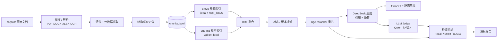

# 智慧停车企业知识库 RAG 问答助手

面向停车运营企业的知识库问答：把标准、收费办法、设备手册、客服规范混合语料入库，用「稠密 + 稀疏混合检索 → 状态/版本过滤 → 重排 → 带引用生成」回答问题，并用可复现的消融评估说明每一层到底带来了多少收益。

## 架构



## 快速开始

```bash
pip install -e ".[dev]"
python scripts/ingest.py --corpus corpus --data data     # 入库：解析 → 清洗 → 切分 → data/chunks.jsonl
python scripts/translate_chunks.py                      # 给英文文档生成中文检索描述（走缓存，可重跑）
python scripts/build_index.py --device cpu              # 重建稠密 + 稀疏索引
python scripts/serve.py --device cpu                    # 起服务，浏览器打开 http://127.0.0.1:8000
```

`translate_chunks.py` 与 `build_index.py` 只在语料或切分变化后需要重跑；描述与模型调用一样按内容哈希缓存，重跑不产生新调用。

无实时环境时（离线、无 API key）可以只跑测试与重建报告：

```bash
python -m pytest -q
python scripts/eval.py --report-only --verdicts eval/judge_verdicts.jsonl --out reports/eval_report.md
```

有 `Makefile` 的机器上等价于 `make ingest` / `make dev` / `make test` / `make eval-report`（Windows 未装 make 时直接用上面的命令）。

完整评估（需要 `.env` 中的 DeepSeek / SiliconFlow key，首次会下载 bge-m3 与 bge-reranker）：

```bash
python scripts/build_eval_set.py --chunks data/chunks.jsonl --out eval/questions.jsonl
python scripts/eval.py --questions eval/questions.jsonl \
  --configs dense_only,dense_bm25_rrf,dense_bm25_rrf_rerank,full \
  --out reports/eval_report.md --device cpu
python scripts/demo.py --device cpu                      # 10 题演示验收，结果逐条落 reports/demo_results.jsonl
```

## 评估结果

> **2026-10-27 首次实测。** 50 题（fact 19 / table 12 / cross_doc 9 / unanswerable 10，其中 20 题人工校对），CPU 本地跑 bge-m3 与 bge-reranker-v2-m3，DeepSeek 生成，**硅基流动上的 Qwen2.5-72B 裁判**（与生成模型异源）。完整报告见 [reports/eval_report.md](reports/eval_report.md)，含 bootstrap 95% 置信区间。
> 同源对照：本轮之前用 DeepSeek 自判跑过一版，两套裁判在 200 组判定上一致率 **94.5%**，分歧集中在正确↔部分正确之间；同源那版的答案正确率整体高约 2 个百分点，方向与「同源略宽松」一致，但幅度落在噪声范围内。
> **2026-10-28 重判。** judge 从「整答案一个是否精确」改为「逐条引用判定」，用 `--rejudge` 只重判不重跑（检索与生成结果未变），生成类指标因此有 ±0.02 的轻微变化。claim 精确率在「有引用的题」上统计：拒答且零引用的题没有可判对象，不计入分母——这类题每配置 3–5 道，全部是拒答题，不构成偏倚。
> **2026-10-28 表格抽取修复。** PDF 表格单元格丢空格、双线边框错列，已修（ADR-011）并重新入库、重建索引。
> **2026-10-29 查询归一化 + 生成侧重测。** 问句开头的文档限定语从检索查询里剥掉（ADR-012）。`dense_only` 与 `full` 两个配置的检索与生成全量重跑（50 题 × 2 配置）。
> **2026-10-30 补齐中间两个配置。** `dense_bm25_rrf` 与 `dense_bm25_rrf_rerank` 的生成与裁判也按当前索引重跑了一遍（ADR-013 的后续）。**下表现在四个配置全部测于同一份索引、同一版 judge，没有任何一格是旧值。**

检索指标（当前索引 + 查询归一化）：

| 配置 | Recall@5 | MRR@10 | nDCG@5 |
| --- | --- | --- | --- |
| dense_only | 0.738 | 0.627 | 0.630 |
| dense_bm25_rrf | 0.887 | 0.747 | 0.763 |
| dense_bm25_rrf_rerank | **0.938** | 0.835 | 0.844 |
| full | **0.938** | 0.835 | 0.844 |

生成指标：

| 配置 | 答案正确率 | 引用精确率(claim) | 引用精确率(strict) | 拒答准确率 | 可答误拒率 |
| --- | --- | --- | --- | --- | --- |
| dense_only | 0.780 | 0.941 | 0.516 | 0.900 | 12.5% |
| dense_bm25_rrf | **0.840** | 0.923 | 0.585 | 0.920 | 10.0% |
| dense_bm25_rrf_rerank | 0.820 | 0.944 | 0.604 | 0.940 | 7.5% |
| full | 0.820 | **0.944** | **0.604** | **0.940** | **7.5%** |

四个配置同一份索引、同一版 judge，无旧值。

**引用精确率为什么有两列。** `strict` 只认落在 gold 区间内的引用。跨文档题的 gold 只锚一份文档，而答题必须同时引用两份——这类题每题最多 0.5 分，9 道题把整体上限压到 0.887，也就是说 0.90 的验收线在这个口径下**数学上不可达**。`claim` 由 judge 逐条判断「这条引用是否直接支撑对应陈述」，不依赖 gold 锚点，是模型真实表现的度量；`strict` 保留为下界。`full` 上两列差 0.34，差的就是「引对了但不是 gold 那一段」。

怎么读这张表：

- **混合检索确实提召回**：Recall@5 从 0.738 到 0.887（+0.149）。但 50 题的置信区间很宽，两组区间仍有重叠，只能说方向一致，不能说显著。
- **重排主要改善排序质量**：MRR@10 从 0.747 到 0.835、nDCG@5 从 0.763 到 0.844，Recall@5 只再涨到 0.938。
- **查询归一化是这一版最大的单项增益**：四个配置的 Recall@5 一起上行，收益全部来自被改写的 11 道表格题（表格分片 0.750 → 1.000），其余 39 道查询逐字未变、结果构造上不可能变。没有模型调用，只多 9 次字符串前缀比较。
- **首尾对比**：纯向量 → 完整链路，答案正确率 0.780 → **0.820**、可答误拒 12.5% → **7.5%**、拒答准确率 0.900 → 0.940。检索召回涨上去之后，生成侧这次跟上了。
- **答案正确率最高的是不含重排的 `dense_bm25_rrf`（0.840），比重排高 0.02**。它的 Recall@5 只有 0.887，可答误拒也是 10% 对 7.5%——也就是说重排把该找的段落找得更全、排得更前，但最终答案反而差一道题。50 题的样本下 0.02 恰好是一道题，落在这套评估的噪声里；能说的只有「重排的收益体现在检索指标和拒答上，没有体现在答案正确率上」，不能据此说重排有害。
- **引用精确率没有跟着涨**：`full` 的 claim 口径从 0.964 落到 0.944（同一口径、不同索引），strict 从 0.521 升到 0.604。检索带回了更多、更靠前的段落，模型也会多引——多出来的引用并非每条都精确。
- **`full` 与重排配置的检索结果完全相同**：语料里 9 份文档没有一份是「失效」状态（6 现行、3 未知），状态过滤在公开语料上没有可过滤的对象。版本治理另用构造组单独测（见下），不在本表的 50 题里。

设计目标（非承诺）：Recall@5 ≥ 0.85、混合+重排相对纯向量提升 ≥ 10%、现行版本选择正确 ≥ 90%、答案正确率 ≥ 80%、引用精确率 ≥ 90%、不可答拒答 ≥ 80%、可答误拒 ≤ 10%。
实测对照：Recall@5 0.938（达）、提升 +0.200（达）、答案正确率 0.820（达）、引用精确率 0.944（达，claim 口径；strict 0.604 见下界说明）、不可答拒答 100%（达）、可答误拒 7.5%（达）。

评估方法见 [docs/eval-methodology.md](docs/eval-methodology.md)，实现选择见 [docs/decisions.md](docs/decisions.md)。

## 验收标准对照（设计文档 §9）

| 项 | 标准 | 当前状态 |
| --- | --- | --- |
| 入库 | ≥95% 文档成功解析；失败项有原因 | ✅ 实测 9/9 成功，0 失败；513 chunks，平均 469.7 字，扫描件 0 份 |
| 检索 | Recall@5 ≥ 0.85；混合+重排提升 ≥10% 且附置信区间 | ✅ 实测 0.938（达）；混合+重排相对纯向量 +0.200（达）；50 题下置信区间仍宽，只能作方向性判断 |
| 版本 | 版本陷阱题选对现行版本 ≥90% | ✅ **构造组实测 5/5（100%）**，同一组不治理时 1/5（20%）。公开语料没有同文号新旧对，按 §9 允许的方式构造：同一文号挂 2019（失效）/2023（仍标现行）/2025 三版，正文除数字外相同，走真实入库→索引→检索（[构造组实测](reports/version-traps.md)）。样本仅 5 题，只证明机制生效，不是统计意义上的达标。另实测过「按草案字样压排名」，四档力度全部掉分，已否决（ADR-014） |
| 生成 | 答案正确率 ≥80%；引用精确率 ≥90% | ✅ 答案正确率 0.820（达，95% CI 0.700–0.920）；引用精确率 0.944（claim 口径，达），strict 口径 0.604 是 gold 单锚下的下界 |
| 拒答 | 不可答拒答 ≥80%；可答误拒 ≤10% | ✅ 不可答 10/10 = 100%（达）；可答误拒 3/40 = 7.5%（达） |
| 演示 | 10 个真实业务问题端到端可答，引用可点开原文 | ⚠️ 2026-10-30 重跑：6 题完整正确、2 题正确拒答、2 题误拒（Q5 子章节没进上下文、Q8 零引用拒答）。可答误拒 25%，与 10-28 持平但构成变了——Q7 已修复、Q8 从「部分」退成「拒答」。引用可点开原文。见 [演示验收](reports/demo-acceptance-2026-10-30.md) |
| 复现 | 一条命令入库；一条命令离线重跑评估 | ✅ 入库已实测；本轮报告已由 `eval/judge_verdicts.jsonl` 产出，`--report-only` 可离线重建 |

## 已实现的能力

- **多格式入库**：PDF 文本层、扫描件 OCR 兜底（RapidOCR）、DOCX 标题层级、XLSX 合并单元格还原；单文件失败隔离并写入报告。
- **结构感知切分**：按标题层级与表格边界切，目标 300–600 字、上限 800、重叠 100，保留 `section_path` / 页码。
- **表格抽取**：PDF 单元格文字按矩形从页面重取（`Table.extract()` 会丢词间空格），列网格只认两行以上共用的竖线，双线边框不再制造空列。
- **混合检索**：bge-m3 稠密 + jieba/BM25 稀疏，RRF 融合；停车领域自定义词典 25 个术语。
- **查询归一化**：问句开头的文档限定语（「大华停车场管理系统V2.0.0中，……」）从检索查询剥掉，按最长公共前缀识别，允许标题简写；生成与状态过滤仍用原话。
- **版本治理**：只硬过滤 `失效`；`未知` 状态保留但乘 0.95；同一文号取生效日期最新的现行版本；问句含「旧/原/以前/历史/废止/年份」时不做过期过滤。
- **重排与生成**：bge-reranker-v2-m3 重排；DeepSeek temperature 0，严格 JSON，逐条陈述带 `[n]` 引用，证据不足时拒答。
- **跨语言检索**：英文文档为每个 chunk 生成中文检索描述（一段概述 + 几条可能的中文问法），dense、sparse 与重排都用它，答案与引用仍用原文。中文 chunk 不受影响。
- **可审计**：每次 LLM 调用按「模型+消息+温度」哈希落盘；评估落盘每条 run record，离线可重建报告。

## 目录

```text
corpus/      原始语料（*.pdf/*.docx 不入库，仅提交 sources.yaml / sources.md / 词典 / 元数据覆写）
data/        入库产物：documents.jsonl、chunks.jsonl、kb.sqlite、qdrant/、bm25.pkl（gitignore）
eval/        评估题、gold、judge 判定（入库，保证可复现）
reports/     入库报告、评估报告
src/parking_kb/  ingest / index / retrieve / generate / eval / api
tests/       单元 + 集成测试（169 passed，6 个 slow 用例默认跳过）
```

## 局限

- **裁判只对到「异源」，没对到「准」**：生成模型 DeepSeek、裁判 Qwen2.5-72B，同源偏袒已排除（两套裁判一致率 94.5%）；逐条引用判定也一样——它比 strict 口径贴近真实表现，但 judge 仍可能放过多引（人工抽查见过一条相邻段落被判为 precise）。judge 与**人工**档位的一致率没测，生成类指标仍是「judge 视角」。
- **题量小**：50 题的置信区间宽达 ±0.12，配置之间 4–8 个百分点的差距多数落在区间重叠范围内，报告里只作方向性判断。
- **语料规模小且公开**：9 份公开标准/办法/手册，不能代表企业内部文档分布；元数据缺失多（`issuer` 9/9 缺、`effective_date` 7/9 缺）。
- **跨语言检索：段落级已经能答，子章节粒度还不行**：大华手册是英文，其余 8 份是中文。给英文 chunk 加中文检索描述之后，演示里「如何添加操作员账号」在 10-30 第一次完整答对（引用 p.50/51 的 Add User 操作说明），此前一直是误拒——「跨语言只能检索、不能回答」这个判断已经不成立。剩下的「如何统计每日收入」不是语言问题：p.80 `3.8` 的一句话概述进了上下文，`3.8.1 Charge Details` 没进，父节与子节的排序没做对。放宽融合池的尝试仍不采纳（检索耗时 11.4s → 26.8s，Recall@5、MRR、nDCG 均无改善，见 [docs/decisions.md](docs/decisions.md) ADR-009/010）。
- **跨文档题仍是短板**：`full` 在 9 道跨文档题上正确率 0.556（5 题对），剩下 3 道可答误拒里有 2 道是跨文档题。检索 Recall@5 已经 0.722，问题出在「证据散在两份文档、只找回一份时模型选择拒答」。
- **查询归一化只认一种写法**：问句必须以文档名起手、后面跟分号。文档名出现在句中（「……那么在大华停车场管理系统中，……」）不剥。演示 10 题没有一题命中这个模式，所以那两题误拒与此无关（ADR-012）。
- **版本治理只在构造组上量过**：公开语料里没有同一文号的新旧版本，也没有「失效」状态的文档。按 §9 允许的方式构造了一组（同一文号三版、正文除数字外相同），实测选对现行版 5/5、不治理时只有 1/5（[构造组实测](reports/version-traps.md)）；但样本只有 5 题，且问句带年份线索时只保证旧版**不过滤**、不保证它排第一——2019 版片段落在第 3 位，因为重排只看正文不看标题。另外试过按「草案 / 征求意见稿」压排名，四档力度实测全部掉分（最温和的一档 MRR 0.835 → 0.708），本语料 4/9 的文档就是草案，它们是很多题的唯一出处，不是被取代的旧稿——已否决并记录（ADR-014）。
- **`未知` 状态的 0.95 降权在默认路径不生效**：重排会按模型分数整体重新赋分，这个乘数被覆盖。实测表明任何基于状态的降权在本语料上都是净损失，因此不修，只如实标注它仅在无重排配置里起作用。
- **CPU 环境**：bge-m3 / reranker 本地 CPU 推理，重排是评估耗时的主要来源；本机无 CUDA，GPU 上可显著加速。
- **扫描件 0 份**：OCR 路径有测试覆盖，但真实扫描件效果未量化。
- **单轮问答**：没有多轮上下文。查询改写只做到规则层（剥文档限定语），没有模型改写或中→英改写——后者才是跨语言误拒的对症修法，代价是每次查询多一次模型调用。
