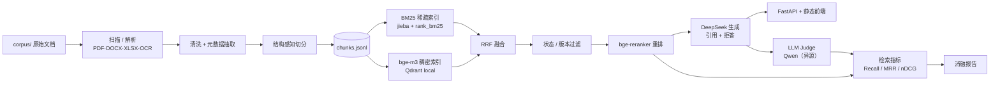

# 智慧停车企业知识库 RAG 问答助手

面向停车运营企业的知识库问答：把标准、收费办法、设备手册、客服规范混合语料入库，用「稠密 + 稀疏混合检索 → 状态/版本过滤 → 重排 → 带引用生成」回答问题，并用可复现的消融评估说明每一层到底带来了多少收益。

## 架构



## 快速开始

```bash
pip install -e ".[dev]"
python scripts/ingest.py --corpus corpus --data data     # 入库：解析 → 清洗 → 切分 → data/chunks.jsonl
python scripts/serve.py --device cpu                    # 起服务，浏览器打开 http://127.0.0.1:8000
```

无实时环境时（离线、无 API key）可以只跑测试与重建报告：

```bash
python -m pytest -q
python scripts/eval.py --report-only --verdicts eval/judge_verdicts.jsonl --out reports/eval_report.md
```

有 `Makefile` 的机器上等价于 `make ingest` / `make dev` / `make test` / `make eval-report`（Windows 未装 make 时直接用上面的命令）。

完整评估（需要 `.env` 中的 DeepSeek / SiliconFlow key，首次会下载 bge-m3 与 bge-reranker）：

```bash
python scripts/build_eval_set.py --chunks data/chunks.jsonl --out eval/questions.jsonl
python scripts/eval.py --questions eval/questions.jsonl \
  --configs dense_only,dense_bm25_rrf,dense_bm25_rrf_rerank,full \
  --out reports/eval_report.md --device cpu
```

## 评估结果

> **2026-10-27 首次实测。** 50 题（fact 19 / table 12 / cross_doc 9 / unanswerable 10，其中 20 题人工校对），CPU 本地跑 bge-m3 与 bge-reranker-v2-m3，DeepSeek 生成，**硅基流动上的 Qwen2.5-72B 裁判**（与生成模型异源）。完整报告见 [reports/eval_report.md](reports/eval_report.md)，含 bootstrap 95% 置信区间。
> 同源对照：本轮之前用 DeepSeek 自判跑过一版，两套裁判在 200 组判定上一致率 **94.5%**，分歧集中在正确↔部分正确之间；同源那版的答案正确率整体高约 2 个百分点，方向与「同源略宽松」一致，但幅度落在噪声范围内。

| 配置 | Recall@5 | 答案正确率 | 引用精确率 | 拒答准确率 | 可答误拒率 |
| --- | --- | --- | --- | --- | --- |
| dense_only | 0.713 | 0.760 | 0.438 | 0.840 | 20.0% |
| dense_bm25_rrf | **0.825** | 0.680 | 0.477 | 0.760 | 30.0% |
| dense_bm25_rrf_rerank | 0.812 | 0.740 | 0.521 | 0.860 | 17.5% |
| full | 0.812 | 0.740 | 0.521 | 0.860 | 17.5% |

怎么读这张表：

- **混合检索确实提召回**：Recall@5 从 0.713 到 0.825（+0.112），Recall@1 从 0.375 到 0.500。但 50 题的置信区间很宽（0.825 的区间是 0.700–0.938），两组区间重叠，只能说方向一致，不能说显著。
- **重排主要改善排序质量**：MRR@10 从 0.680 到 0.743、nDCG@5 从 0.706 到 0.741，Recall@1 到 0.575；Recall@5 反而略降到 0.812。
- **召回涨了，正确率没跟上**：`dense_bm25_rrf` 的正确率 0.680 反而低于纯向量的 0.760，主要来自跨文档题 0/9 全错——检索把两份文档都找回来了，但模型在证据不完整时选择拒答，或者拿另一份文档顶替。
- **`full` 与重排配置完全相同**：语料里 9 份文档没有一份是「失效」状态（6 现行、3 未知），状态过滤没有可过滤的对象。版本治理这条链目前只由单元测试保证，本语料测不出来。

设计目标（非承诺）：Recall@5 ≥ 0.85、混合+重排相对纯向量提升 ≥ 10%、现行版本选择正确 ≥ 90%、答案正确率 ≥ 80%、引用精确率 ≥ 90%、不可答拒答 ≥ 80%、可答误拒 ≤ 10%。
实测对照：Recall@5 0.825（未达）、提升 +0.112（达）、答案正确率 0.740（未达）、引用精确率 0.521（未达）、不可答拒答 100%（达）、可答误拒 17.5%（未达）。

评估方法见 [docs/eval-methodology.md](docs/eval-methodology.md)，实现选择见 [docs/decisions.md](docs/decisions.md)。

## 验收标准对照（设计文档 §9）

| 项 | 标准 | 当前状态 |
| --- | --- | --- |
| 入库 | ≥95% 文档成功解析；失败项有原因 | ✅ 实测 9/9 成功，0 失败；513 chunks，平均 469.7 字，扫描件 0 份 |
| 检索 | Recall@5 ≥ 0.85；混合+重排提升 ≥10% 且附置信区间 | ⚠️ 实测 0.825（未达 0.85）；混合相对纯向量 +0.112（达），但置信区间重叠 |
| 版本 | 版本陷阱题选对现行版本 ≥90% | ⏳ 无法评估：题库里 version 题为 0，语料也无同文号新旧对；版本过滤只有单元测试覆盖 |
| 生成 | 答案正确率 ≥80%；引用精确率 ≥90% | ⚠️ 实测 0.760 / 0.521，两项均未达；引用精确率差距明显，见失败案例 |
| 拒答 | 不可答拒答 ≥80%；可答误拒 ≤10% | ⚠️ 不可答 10/10 = 100%（达）；可答误拒 7/40 = 17.5%（未达） |
| 演示 | 10 个真实业务问题端到端可答，引用可点开原文 | ⏳ 页面与 API 已完成并有自动化测试；手工 10 题验收待做 |
| 复现 | 一条命令入库；一条命令离线重跑评估 | ✅ 入库已实测；本轮报告已由 `eval/judge_verdicts.jsonl` 产出，`--report-only` 可离线重建 |

## 已实现的能力

- **多格式入库**：PDF 文本层、扫描件 OCR 兜底（RapidOCR）、DOCX 标题层级、XLSX 合并单元格还原；单文件失败隔离并写入报告。
- **结构感知切分**：按标题层级与表格边界切，目标 300–600 字、上限 800、重叠 100，保留 `section_path` / 页码。
- **混合检索**：bge-m3 稠密 + jieba/BM25 稀疏，RRF 融合；停车领域自定义词典 25 个术语。
- **版本治理**：只硬过滤 `失效`；`未知` 状态保留但乘 0.95；同一文号取生效日期最新的现行版本；问句含「旧/原/以前/历史/废止/年份」时不做过期过滤。
- **重排与生成**：bge-reranker-v2-m3 重排；DeepSeek temperature 0，严格 JSON，逐条陈述带 `[n]` 引用，证据不足时拒答。
- **可审计**：每次 LLM 调用按「模型+消息+温度」哈希落盘；评估落盘每条 run record，离线可重建报告。

## 目录

```text
corpus/      原始语料（*.pdf/*.docx 不入库，仅提交 sources.yaml / sources.md / 词典 / 元数据覆写）
data/        入库产物：documents.jsonl、chunks.jsonl、kb.sqlite、qdrant/、bm25.pkl（gitignore）
eval/        评估题、gold、judge 判定（入库，保证可复现）
reports/     入库报告、评估报告
src/parking_kb/  ingest / index / retrieve / generate / eval / api
tests/       单元 + 集成测试（130 passed，1 slow 用例默认跳过）
```

## 局限

- **裁判只对到「异源」，没对到「准」**：生成模型 DeepSeek、裁判 Qwen2.5-72B，同源偏袒已排除（两套裁判一致率 94.5%）；但 judge 与**人工**档位的一致率还没测——20 题人工校对核的是 gold，没逐条复核 correct/partial/wrong。生成类指标仍是「judge 视角」，不是「人视角」。
- **题量小**：50 题的置信区间宽达 ±0.12，配置之间 4–8 个百分点的差距多数落在区间重叠范围内，报告里只作方向性判断。
- **语料规模小且公开**：9 份公开标准/办法/手册，不能代表企业内部文档分布；元数据缺失多（`issuer` 9/9 缺、`effective_date` 7/9 缺）。
- **无版本对**：公开语料里没有同一文号的新旧版本，也没有「失效」状态的文档，版本治理目前只有单元测试覆盖，没有真实陷阱题成绩。
- **CPU 环境**：bge-m3 / reranker 本地 CPU 推理，重排是评估耗时的主要来源；本机无 CUDA，GPU 上可显著加速。
- **扫描件 0 份**：OCR 路径有测试覆盖，但真实扫描件效果未量化。
- **单轮问答**：没有多轮上下文、没有查询改写（设计文档列为可选增益项，需评估证明后才保留）。
