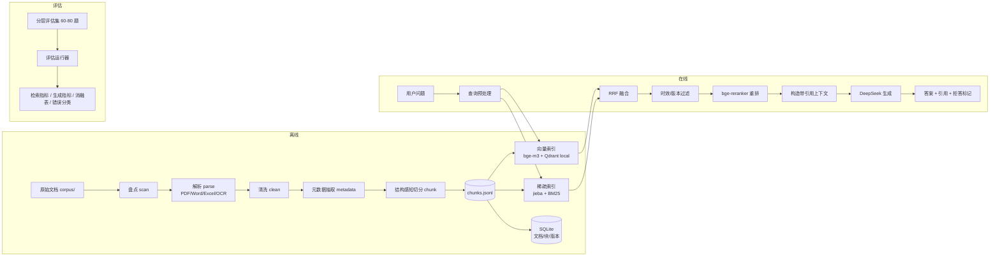

# 智慧停车企业知识库 RAG 问答助手 — 设计文档

- **版本**：v1.0
- **日期**：2026-10-26
- **性质**：简历项目 / LLM 应用与算法方向
- **状态**：待确认

---

## 1. 意图与为什么

做一个面向停车企业内部的问答助手：员工用自然语言提问，系统从企业文档（制度、标准、收费办法、设备手册、运营 SOP、客服话术）中检索证据，给出**带出处、带生效日期**的答案。

这个项目的目的不是"再做一个 RAG demo"，而是证明三件事：

1. 面对异构、脏、有时效冲突的真实企业文档，能做出**有依据的工程判断**（怎么解析、怎么切、怎么召回、怎么处理新旧版本）。
2. 能用**可复现的评估**证明每个设计选择有效，而不是凭感觉调参。
3. 能说清楚失败在哪里，并把失败分类、量化、修复。

目标岗位偏 LLM 应用 / 算法，因此检索质量与评估体系是主线，后端工程与前端只做到"能演示、能讲清楚"。

**为什么是停车行业**：真实资料可得；文档类型齐全且形态差异大；制度类问题有明确对错，天然适合构建评估集；行业内新旧收费标准并存，提供了"版本陷阱"这类高价值测试场景。

---

## 2. 目标 / 非目标 / 反目标

### 2.1 目标

- 建立一条可复现的文档入库流水线：异构文档 → 带元数据的结构化语料。
- 实现结构感知切分、混合检索（向量 + BM25）、重排、时效/版本过滤。
- 生成答案必须带引用，引用能定位到文档、章节、页码；证据不足时必须拒答。
- 构建 60~80 题的分层评估集，输出检索指标与生成指标的消融对比。
- 提供可演示的 Web 界面与一键复现脚本。

### 2.2 非目标

- 多租户、细粒度权限、SSO、审计等企业级能力。
- 生产部署、高可用、水平扩展。
- 微调嵌入模型或生成模型。
- 图片/图表理解（表格做结构化处理，但不做图像语义理解）。
- 语音、多模态输入。

### 2.3 反目标（即使技术跑通也算失败）

- 答案流畅但引用错误或张冠李戴。
- 用自己生成的简单问题评估自己，指标好看但没有说服力。
- 只展示成功案例，不展示失败分析与实际指标。
- 为了"高级"堆 Agentic 流程，导致无法评估、无法解释。

---

## 3. 约束

| 类别 | 约束 |
|------|------|
| 时间 | 快速冲刺，约 10 个工作日 |
| 数据 | 开发期使用公开语料（政策/标准/收费办法/设备手册/客服规范），后续替换为真实企业资料，架构不变 |
| 数据出境 | 文档内容可发送至 DeepSeek API，已确认 |
| 硬件 | Windows 11，Python 3.11，RTX 4070 Laptop 8GB，无 Docker |
| 语言 | 中文文档、中文提问 |
| 版权 | 原始语料与生成数据不入库；仓库只提交 `corpus/sources.md` 清单与来源说明 |
| 可复现 | 见 §3.1 可复现契约 |

### 3.1 可复现契约

仓库提交与不提交的边界必须明确，否则“离线重跑评估”和“原始语料不入库”会互相矛盾。

| 内容 | 是否提交 | 说明 |
|------|----------|------|
| 原始语料 | 否 | 版权原因；`corpus/sources.md` 记录来源与许可说明 |
| 语料下载脚本 | 是 | `scripts/fetch_corpus.py`，按公开 URL 重新拉取 |
| 评估题与 gold | 是 | 自建衍生数据；gold 采用“文档 + 字符区间 + 短引文” |
| 最终评估判定缓存 | 是 | 只提交 `eval/judge_verdicts.jsonl`（题号、配置、判定、简短理由），不含完整上下文 |
| 运行期 LLM 缓存 | 否 | 体积大，gitignored |
| 生成产物（chunks/索引） | 否 | 可由脚本重建 |

两条可复现路径：

1. **离线复现指标**：克隆后 `make eval-report`，读取已提交的判定缓存重算指标表，不联网、不需要 API key。
2. **全链路复现**：`make fetch-corpus && make ingest && make eval`，需要网络与 API key；结果应与提交报告一致，允许模型非确定性带来的极小差异并在报告中注明。

---

## 4. 方案选型

### A. 最小可用 RAG

固定长度切分 → 纯向量检索 → top-k → 生成。

- 优点：3~4 天可完成，风险最低。
- 缺点：与常见 demo 同质化；无法回答"切分依据、召回失败怎么办、如何证明有效"。
- 结论：不选。简历价值不足。

### B. 结构感知 + 混合检索 + 重排 + 时效治理 + 评估闭环（**已选**）

按标题层级切分、表格结构化；BM25 + 向量混合召回，RRF 融合；cross-encoder 重排；元数据过滤处理新旧版本；配套分层评估集与消融实验。

- 优点：每个环节都可解释、可度量；两周内可完成；与目标岗位高度匹配。
- 缺点：工程量大于 A，需要认真做评估集。
- 结论：**选用**。

### C. Agentic RAG

查询改写/分解、路由、自检、多轮。

- 优点：概念上更"高级"。
- 缺点：评估链路长、调试成本高；在 B 的基础未打牢时只是花架子，冲刺期容易烂尾。
- 结论：不作为主线。若 B 提前完成，作为可选增量加"轻量查询改写"，并用同一评估集证明增益。

---

## 5. 总体架构



**设计原则**：离线与在线严格分离；所有中间产物落盘；任何在线结果都能回溯到具体 chunk 和原始页码。

---

## 6. 模块设计

### 6.1 文档接入层（`src/parking_kb/ingest/`）

#### 盘点 `scan.py`

- 遍历 `corpus/`，记录：路径、扩展名、大小、SHA-256、页数、是否含文本层、可提取字符数、是否疑似扫描件。
- 输出 `data/inventory.jsonl` 与 `reports/inventory.md`。
- 扫描件判定：PDF 每页可提取字符数中位数低于阈值（如 50 字符/页）。

#### 解析 `parse/`

| 类型 | 方案 | 说明 |
|------|------|------|
| 文本 PDF | PyMuPDF 提取文本块 + 字号/加粗信息 | 保留标题层级线索 |
| 表格 PDF | pdfplumber 表格抽取 | 表格转 Markdown，保留表头 |
| 扫描 PDF | 页面渲染 200~300 DPI + RapidOCR | PaddleOCR 作为备选；逐页记录 OCR 置信度 |
| Word | python-docx | 使用 Heading 样式还原层级；表格转 Markdown |
| Excel | openpyxl / pandas | 每个 sheet 转 Markdown 表；保留 sheet 名与表头 |
| HTML（可选） | 正文抽取 | 保存的网页资料 |

每份文档产出统一的中间结构：`Document → Sections → Blocks`，块类型包括 `heading / paragraph / table / list / ocr_text`。

#### 清洗 `clean.py`

- 页眉页脚：检测跨页重复行（同一相对位置出现比例 > 60%）后删除。
- 页码、水印、乱码、控制字符清除。
- 段落重连：PDF 中被硬换行截断的中文句子重新拼接；保留标题、列表、表格行。
- 近重复段落：shingle Jaccard > 0.9 时去重。
- 不做过度归一化（保留中文标点与数字格式），避免破坏收费条款等细节。

#### 元数据抽取 `metadata.py`

抽取字段：

| 字段 | 来源 |
|------|------|
| `doc_id` | 文件哈希 |
| `title` | 文件名 + 首页标题 |
| `doc_no` | 正则匹配文号（如 湘发改价费规〔2025〕723号） |
| `doc_type` | 法规 / 标准 / 收费办法 / 设备手册 / 运营 SOP / 客服话术 |
| `issuer` | 发布机构 |
| `effective_date` | “自 X 年 X 月 X 日起施行”等模式 |
| `status` | 现行 / 失效 / 未知 |
| `version` | 版本或文号 |
| `source_url` | 来源链接 |
| `page_count` | 页数 |

策略：正则优先；无法确定的字段允许 `corpus/metadata_overrides.yaml` 人工覆盖。不把 LLM 抽取作为默认路径，避免不可复现。

检索层只硬过滤 `status=失效`；`status=未知` 保留并降权（见 §6.3），避免正则抽取失败导致语料被静默剔除。收费办法、标准等关键文档必须通过 override 明确 status 与生效日期。

#### 结构感知切分 `chunk.py`

- 先按标题层级构建章节树，再在章节内切分。
- 目标长度 300~600 中文字符，最大 800；小于 100 字符的块与相邻块合并。
- 超长章节按句子边界递归切分，重叠 100 字符。
- 表格独立成块：表格转 Markdown，重复表头；超大表按行组分块并保留表头。
- 每个 chunk 携带完整元数据与 `section_path`、`page_start/page_end`。
- 输出 `data/documents.jsonl`、`data/chunks.jsonl`。

#### 入库报告 `report.py`

必须包含：文档总数、解析成功/失败清单及原因、扫描件比例、空页数、表格数、chunk 长度分布、元数据缺失统计、近重复删除量。

**原则：不允许静默失败。** 任何解析异常的文档都要在报告里出现。

### 6.2 索引层（`src/parking_kb/index/`）

- **稠密索引**：bge-m3（GPU，fp16），向量归一化，Qdrant 本地持久化模式（`data/qdrant`），payload 存元数据。
- **稀疏索引**：jieba 分词 + rank_bm25，持久化为本地文件。
- **元数据存储**：SQLite，存文档、chunk、版本关系，供过滤与引用展示。
- **增量更新**：以文件哈希 + 流水线版本号判断是否重建；`data/manifest.json` 记录状态。

### 6.3 检索层（`src/parking_kb/retrieve/`）

流程：

1. 查询规范化。
2. 稠密召回 top 20；BM25 召回 top 20。
3. RRF 融合（k=60），取 top 20。
4. 时效/版本过滤：
   - 硬过滤仅排除 `status=失效`（已确认被替代）的文档；`status=未知` 保留但排序降权（如融合分数 ×0.95），并在结果中标记。
   - 若问题含历史/版本线索（“2023 年”“旧标准”“原来”），取消硬过滤并允许召回历史版本。
   - 同一文号存在多版本时，默认保留最新现行版，除非问题明确指向旧版。
   - 关键文档（收费办法、标准）的 status 与生效日期以 override 为准，不依赖正则。
5. bge-reranker 重排，取 top 5~8。
6. 返回 chunk + 分数 + 元数据。

**消融配置**（必须都能跑）：

- `dense_only`
- `dense_bm25_rrf`
- `dense_bm25_rrf_rerank`
- `full`（再加时效/版本过滤）

### 6.4 生成层（`src/parking_kb/generate/`）

- Prompt 独立文件并带版本号（`prompts/answer_v1.md`）。
- 上下文块格式：

```text
[1] 《湖南省机动车停放服务收费管理办法》（湘发改价费规〔2025〕723号，2026-01-01 生效，现行）
    章节：第二章 收费标准的制定 > 第十条
    页码：p.3
    内容：……
```

- 生成规则：
  - 只允许使用给定上下文。
  - 每个事实性陈述必须带 `[n]` 引用。
  - 证据不足时明确拒答，并说明缺什么，不允许猜。
  - 新旧版本冲突时优先现行版，并在答案中说明生效日期。
  - 金额、时限、比例等数字必须逐字来自上下文。
- 输出结构化：`{answer, citations: [{n, chunk_id}], abstained, missing}`。
- DeepSeek 调用：temperature 0，记录 prompt/completion tokens、耗时、成本；失败重试与超时降级。
- 所有调用落缓存（`data/llm_cache/`），key = hash(model + prompt + params)。

### 6.5 评估层（`src/parking_kb/eval/`）

#### 评估集构建

- 从 chunk 中生成候选问题与标准答案，分层抽样，目标 60~80 题。
- 题型分层：
  1. 单文档事实查找
  2. 表格/价目查询
  3. 跨文档对比与综合
  4. 版本/时效陷阱（新旧标准）
  5. 不可答问题（语料中没有答案）
- 每题字段：`question / gold_answer / gold_span / type / difficulty / source_docs / verified`。
- `gold_span` 记录 `doc_id + char_start + char_end + quote`，评估时由脚本映射到 chunk。**切分参数变化不会使标注失效**，第 9 天仍可安全调整切分并重新映射。
- 固定划分开发集（调参）与报告集（只用于最终报告），避免在同一批题上调参后再汇报。
- 首轮人工校对 20 题（约 40 分钟）；第 9 天若有余力补到 40 题，报告注明最终校对规模。未校对题目标注 `verified: false`，报告分开呈现“已校对子集”与“全量集”。
- 指标口径：全量集报点估计，已校对子集做一致性校准；样本量不足时给出置信区间，不用单题差异下结论。

#### 指标

检索：

- Recall@1 / Recall@5 / Recall@10
- MRR@10
- nDCG@5

生成：

- 答案正确性（LLM judge 对照 gold answer，三档：正确/部分正确/错误）
- Faithfulness（答案中的陈述是否被引用块支持）
- 引用精确率 / 召回率
- 拒答准确率（不可答题是否拒答、可答题是否误拒）

评估可靠性：

- **Judge 模型与生成模型异源**：SiliconFlow 上的 Qwen 系列，模型名由 `JUDGE_MODEL` 环境变量指定。若调用失败，退化到 DeepSeek 并在报告中注明“自评偏差”局限。
- Faithfulness 采用逐句 claim 判定；正确性采用对照 gold 的三档评分；均保留理由。
- LLM judge 在人工校对子集上的一致性（报告一致率）。
- 所有判定保留理由，便于抽查。

#### 消融与错误分析

- 输出 `reports/eval_report.md`：消融表、分题型指标、失败案例、错误分类。
- 错误分类：解析错误 / 切分边界 / 召回缺失 / 重排错误 / 版本混淆 / 生成幻觉 / 拒答错误 / 评估集问题。

### 6.6 服务与演示（`src/parking_kb/api/`）

- FastAPI：
  - `POST /chat`：问题 → 答案 + 引用 + 调试信息（可选）。
  - `GET /health`
  - `GET /documents`：已入库文档列表。
  - `POST /admin/reindex`：可选。
- 前端：单个静态页面（HTML + 原生 JS 或轻量框架），聊天式界面；点击引用展开原文片段、文档标题、生效日期、页码。
- 提供 `scripts/dev.ps1` 与 `scripts/ingest.ps1` 一键启动/重建。
- 不用 Streamlit，保留前后端分离的工程表达。

### 6.7 测试（`tests/`）

- 单元测试：
  - 页眉页脚识别、段落重连、chunk 边界、表格转 Markdown
  - RRF 融合、版本过滤、日期解析
  - 引用映射、拒答逻辑
- 集成测试：3 份小样本文档 → 入库 → 检索 → 假 LLM 生成 → 断言引用正确。
- LLM 相关测试全部注入假实现，保证离线、确定性。
- 评估缓存命中时，`pytest` 不联网。

---

## 7. 目录结构

```text
parking-kb-rag/
├── README.md
├── pyproject.toml
├── .env.example
├── .gitignore
├── corpus/                     # 原始文档（gitignored）
│   └── sources.md              # 来源清单与版权说明（提交）
├── data/                       # 所有生成产物（gitignored）
│   ├── inventory.jsonl
│   ├── documents.jsonl
│   ├── chunks.jsonl
│   ├── qdrant/
│   ├── kb.sqlite
│   ├── bm25.pkl
│   ├── llm_cache/
│   └── manifest.json
├── docs/
│   ├── design/2026-10-26-parking-kb-rag-design.md
│   ├── decisions.md            # 轻量 ADR
│   └── eval-methodology.md
├── prompts/
│   └── answer_v1.md
├── reports/                    # 提交小型 Markdown 报告
│   ├── inventory.md
│   ├── ingest_report.md
│   └── eval_report.md
├── src/parking_kb/
│   ├── config.py
│   ├── ingest/{scan,parse,clean,metadata,chunk,report}.py
│   ├── index/{dense,sparse,store}.py
│   ├── retrieve/{hybrid,filters,rerank}.py
│   ├── generate/{client,prompt,schema}.py
│   ├── eval/{build_set,metrics,judge,run}.py
│   └── api/{main.py,static/}
├── scripts/
└── tests/
```

---

## 8. 排期（10 个工作日）

| 天 | 工作 | 验收 |
|----|------|------|
| 1 | 项目脚手架、语料下载、盘点报告 | `reports/inventory.md` 产出；确认扫描件比例、是否存在同文号新旧版本；凑不出成对版本则启用备选题型（见 §9） |
| 2 | PDF/Word/Excel/OCR 解析 + 清洗 | 解析成功率 ≥95%，失败有原因 |
| 3 | 元数据 + 结构感知切分 + 单测 | chunk 抽样人工可读；**切分配置冻结**；评估 gold 采用字符区间锚定 |
| 4 | 稠密 + BM25 索引、基线检索 | dense_only 能跑通并出指标 |
| 5 | RRF + 重排 + 第一次消融 | 消融表初版 |
| 6 | 版本过滤 + 生成 + 引用 + 拒答 | 端到端问答可演示 |
| 7 | 评估集构建 + 人工校对 | 60~80 题，首轮 20 题已校对；第 9 天视余力补到 40 题 |
| 8 | 全量评估 + 全消融 | `reports/eval_report.md` |
| 9 | 错误分析 + 针对性修复 | 错误分类、修复前后对比 |
| 10 | 演示界面 + README + 简历要点 | 一键复现，10 个真实问题可答 |

缓冲：第 9~10 天同时承担延期缓冲；若落后，优先保评估与报告，砍前端美化。

---

## 9. 验收标准

| 项 | 标准 |
|----|------|
| 入库 | ≥95% 文档成功解析；失败项全部有原因记录 |
| 检索 | Recall@5 ≥ 0.85（已校对子集）；混合+重排相对纯向量提升 ≥10%（Recall@5 或 nDCG@5）；提升结论附置信区间，避免小题量噪声 |
| 版本 | 时效/版本陷阱题正确选择现行版本 ≥90%；若公开语料凑不出同文号新旧对，改用“国家/省/市同主题不同效力”构造，并如实标注题型 |
| 生成 | 答案正确率 ≥80%；引用精确率 ≥90% |
| 拒答 | 不可答题正确拒答 ≥80%，可答题误拒 ≤10% |
| 演示 | 10 个真实业务问题端到端可答，引用可点开原文 |
| 复现 | 一条命令完成入库；一条命令重跑评估（缓存命中，不联网） |

以上为**目标值**，不是承诺值。最终报告如实给出实测数字，达不到就分析原因——这本身就是项目价值的一部分。

---

## 10. 风险与应对

| 风险 | 影响 | 应对 |
|------|------|------|
| 扫描件 OCR 质量差 | 解析失败、评估失真 | 先量化扫描件比例；低质量文档标记并从评估集剔除；必要时换 OCR 引擎 |
| 评估集由 LLM 生成，偏简单 | 指标虚高 | 分层题型 + 人工校对 + 不可答/版本陷阱题；报告区分已校对/未校对 |
| LLM judge 有偏 | 生成指标不可信 | 人工校对子集上算一致率；保留判定理由；关键结论人工复核 |
| bge-m3 显存不足 | 索引失败 | fp16、批大小调小；备选硅基流动 API 嵌入 |
| 中文 BM25 分词不佳 | 混合检索增益不明显 | jieba 自定义词典加入停车术语；对比分词前后指标 |
| API 成本/限流 | 评估跑不完 | 全量缓存；评估分批；失败重试与断点续跑 |
| 时间不足 | 功能砍半 | 优先保"入库 + 检索 + 评估 + 报告"，前端与增量功能可砍 |
| 语料版权 | 不能公开仓库 | 原始文档 gitignore；只提交来源清单与自建数据 |

---

## 11. 已定的实现选择（builder calls）

以下为实现层选择，若施工中发现更合适的替代，可在 `docs/decisions.md` 记录后调整：

- 向量库：Qdrant 本地模式（无 Docker）。
- 嵌入：bge-m3，本地 GPU；重排：bge-reranker 系列。
- 稀疏检索：jieba + rank_bm25。
- 生成：DeepSeek API（OpenAI 兼容接口），temperature 0。
- OCR：RapidOCR 优先，PaddleOCR 备选。
- 前端：FastAPI + 静态页面，不用 Streamlit。
- 切分目标：300~600 中文字符，最大 800，重叠 100。
- 评估缓存：所有 LLM 调用按内容哈希落盘。
- 可复现契约：原始语料不入库；评估题、gold、最终判定缓存入库（见 §3.1）。
- 版本过滤：只硬过滤 `失效`，`未知` 降权保留。
- gold 标注：字符区间锚定，切分参数可变而不失效。
- Judge：SiliconFlow Qwen 系列（`JUDGE_MODEL`），与生成模型异源；失败时退化到 DeepSeek 并注明偏差。
- 人工校对：首轮 20 题，第 9 天视余力补到 40 题；报告注明最终规模。

---

## 12. 留给实现者的空间

- OCR 引擎与 PDF 表格抽取库的具体选型（受 Windows 安装成功率影响）。
- 是否在完成主线后增加轻量查询改写（需用同一评估集证明增益，否则不保留）。
- 前端交互细节与视觉风格。
- 评估集的具体题目分布（在分层比例内调整）。
- 是否加入 Docker 化（当前环境无 Docker，非目标）。
- 剩余选择均为实现层可自决事项，无阻塞性未决项。
